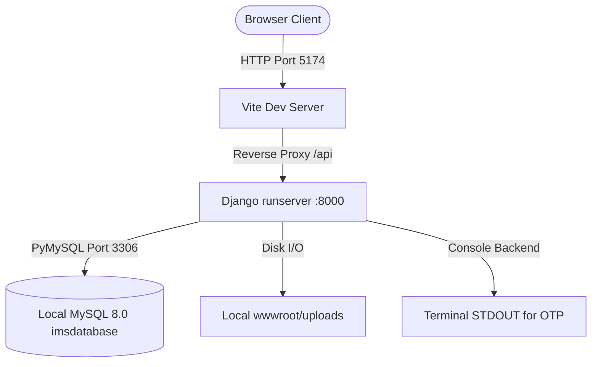
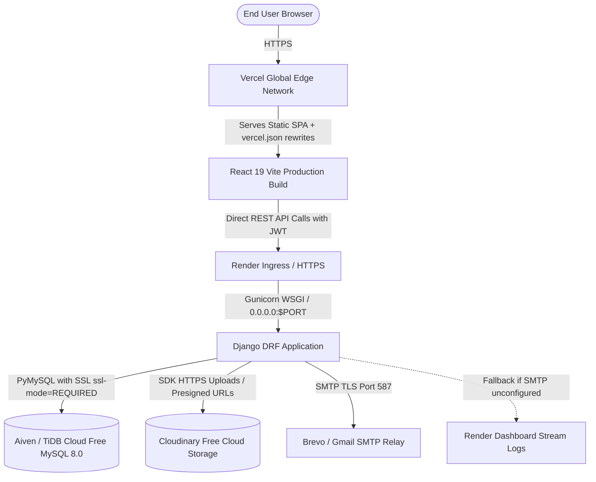

# Enterprise WMS — Free Cloud Deployment Readiness Audit Report

> **Document Type:** Production Readiness & Free Cloud Architecture Audit  
> **Target Environment:** Free-Tier Cloud Ecosystem (Vercel Hobby + Render Free + Aiven / TiDB MySQL + Cloudinary Free)  
> **Source Control:** [Harinath2112/Enterprise-WMS-Inventory-Control-Hub](https://github.com/Harinath2112/Enterprise-WMS-Inventory-Control-Hub)  
> **Audit Status:** Complete (Phase 1 — Deep Audit Only; Non-Destructive / Read-Only Analysis)  
> **Auditor Roles:** Senior Full-Stack Architect, Django Developer, React Developer, MySQL Specialist, DevOps Engineer, Application Security Engineer  

---

## 1. Executive Summary

This audit evaluates the deployment readiness of the **Enterprise WMS / Inventory Control Hub** project for a completely free cloud hosting architecture.

The project is a full-stack Enterprise Resource Planning & Warehouse Management System consisting of:
- **Frontend:** React 19.2 + Vite 8 Single Page Application (SPA) with modern responsive dashboard, transaction registers, inventory controls, POS sales, and PDF document generators.
- **Backend:** Python Django 5.0+ and Django REST Framework (DRF) 3.15+ exposing 120+ REST API endpoints with custom JWT authentication, Role-Based Access Control (RBAC), and transactional stock ledger tracking.
- **Database:** MySQL 8.0 schema containing 84 tables (including 4 legacy backup tables and 1 EF migration history table), indexed foreign-key constraints, and unmanaged Django ORM models.

### Overall Assessment
The codebase has high functional maturity, zero raw SQL injection vectors, comprehensive atomic inventory transaction controls, and passes both Django system checks and automated test suites cleanly. The Vite production build also compiles without errors (1.12s build time). 

However, **it cannot be deployed directly to cloud services in its current state** due to **6 Critical Blockers** (such as missing WSGI server, ephemeral disk uploads on Render, lack of MySQL SSL configuration for managed cloud databases, and missing SPA rewrite rules on Vercel).

All blockers can be remediated without altering any existing business logic, frontend UI layouts, database tables, or API response contracts.

---

## 2. Existing vs. Target Cloud Architecture

### Existing Local Development Architecture


### Target Free-Tier Cloud Production Architecture


---

## 3. Technology & Dependency Inventory

### 3.1 Frontend Dependencies ([frontend/package.json](file:///d:/hari/Projects/Enterprise-WMS-Inventory-Control-Hub/frontend/package.json))

| Dependency | Installed Version | Production Purpose | Free Cloud Compatibility Status |
| :--- | :--- | :--- | :--- |
| `react` | `^19.2.5` | Core UI library | **Verified Compatible** |
| `react-dom` | `^19.2.5` | DOM renderer | **Verified Compatible** |
| `react-router-dom`| `^7.14.1` | Client-side SPA routing | **Requires `vercel.json` rewrite** |
| `lucide-react` | `^1.8.0` | UI Icons | **Verified Compatible** |
| `recharts` | `^3.8.1` | Analytics and dashboard charts | **Verified Compatible** |
| `react-select` | `^5.10.2` | Master dropdown selectors | **Verified Compatible** |
| `jspdf` | `^4.2.1` | Client-side PDF generation | **Verified Compatible** |
| `jspdf-autotable` | `^5.0.8` | Table layout for generated PDFs | **Verified Compatible** |
| `vite` | `^8.0.9` | Frontend build bundler | **Verified Compatible (Build verified in 1.12s)** |

### 3.2 Backend Dependencies ([backend/requirements.txt](file:///d:/hari/Projects/Enterprise-WMS-Inventory-Control-Hub/backend/requirements.txt))

| Dependency | Existing Spec | Production Purpose | Gap / Free Cloud Requirement |
| :--- | :--- | :--- | :--- |
| `Django` | `>=5.0,<5.3` | Core web framework | **Verified Compatible** |
| `djangorestframework` | `>=3.15` | REST API framework | **Verified Compatible** |
| `PyJWT` | `>=2.8` | JWT signing & validation | **Verified Compatible** |
| `bcrypt` | `>=4.1` | Password hashing | **Verified Compatible** |
| `PyMySQL` | `>=1.1` | Pure Python MySQL driver | **Requires SSL configuration in Django settings** |
| `openpyxl` | `>=3.1` | Excel file export | **Verified Compatible (in-memory streaming)** |
| `reportlab` | `>=4.0` | Server-side invoice PDF generation | **Verified Compatible (in-memory streaming)** |
| `qrcode[pil]` | `>=7.4` | QR code generation | **Verified Compatible** |
| `python-barcode` | `>=0.15` | Barcode generation | **Verified Compatible** |
| `django-cors-headers` | `>=4.3` | Cross-Origin Resource Sharing | **Requires production origin configuration** |
| *Missing* | — | WSGI Production Server | **CRITICAL: `gunicorn>=21.2` required for Render** |
| *Missing* | — | Production Static File Serving | **HIGH: `whitenoise>=6.6` recommended** |
| *Missing* | — | Persistent Cloud Media Storage | **CRITICAL: `cloudinary>=1.38` required for uploads** |
| *Missing* | — | TLS/SSL Cryptography for PyMySQL | **HIGH: `cryptography>=42.0` required for cloud MySQL SSL** |

---

## 4. Git Repository & Branch Status

- **Remote URL:** `https://github.com/Harinath2112/Enterprise-WMS-Inventory-Control-Hub.git`
- **Active Branch:** `main` (synchronized with `origin/main`)
- **Working Tree:** Clean (zero unstaged code modifications; only untracked `Commands.txt` scratch note).
- **Commit History:** Preserved commit `20954ed` (`Initial commit - Python Django Full Stack`).
- **Secrets Audit in Git History:**
  - `backend/.env` is **NOT tracked** in Git history (verified via `git ls-tree`).
  - `frontend/.env` is **NOT tracked** in Git history.
  - Root `.gitignore` and `backend/.gitignore` properly exclude `.env`, `*.log`, `__pycache__`, `venv/`, and `node_modules/`.
  - Only clean templates (`.env.example`) are committed.

---

## 5. MySQL Database Architecture & Compatibility Analysis

### 5.1 Schema Structure ([database/imsdatabase.sql](file:///d:/hari/Projects/Enterprise-WMS-Inventory-Control-Hub/database/imsdatabase.sql))
- **Total Tables:** 84 tables.
- **Active Tables:** 79 core business tables (including inventory, orders, customers, suppliers, users, roles, permissions, audit logs, system settings).
- **Auxiliary Tables:**
  - `__efmigrationshistory` (12 historical migration records from legacy .NET backend).
  - 4 backup tables: `purchase_return_items_backup_20260821`, `purchase_returns_backup_20260821`, `role_permissions_backup`, `sales_return_items_backup`.
- **Stored Procedures & Triggers:** **0 (None)**. Verified that all data validation and transactions are managed cleanly by the Django application layer.
- **Views:** **0 (None)**.
- **Collation:** `utf8mb4_0900_ai_ci` (MySQL 8.0 standard).
- **Special Data Types:**
  - `bit(1)` fields used for flags (`is_deleted`, `can_view`, etc.). Handled by custom `BitBooleanField` in `backend/api/core/fieldtypes.py`.

### 5.2 Managed Cloud MySQL Compatibility (Aiven & TiDB)

#### Aiven Free MySQL Plan Evaluation:
1. **Database Name Restriction:** Aiven automatically assigns a provisioned database name (commonly `defaultdb`). Line 1 of `imsdatabase.sql` contains `CREATE DATABASE IF NOT EXISTS imsdatabase; USE imsdatabase;`. Aiven cloud users (`avnadmin`) lack global `CREATE DATABASE` privileges, which will trigger `ERROR 1044 (42000): Access denied`.
   - *Fix:* Import the dump directly into `defaultdb` using the `--force` flag or a prepared script without `CREATE DATABASE` / `USE`.
2. **Mandatory SSL (`ssl-mode=REQUIRED`):** Aiven MySQL strictly rejects non-SSL connections. Current `settings.py` specifies only `OPTIONS: {"charset": "utf8mb4"}` without SSL parameters. This causes PyMySQL connection drops or access denied errors.
   - *Fix:* Configure `"ssl": {"ssl_mode": "REQUIRED"}` in `DATABASES['default']['OPTIONS']`.
3. **Availability / Regional Constraints:** Aiven's persistent free MySQL tier availability varies by cloud region and promotional quota. If Aiven MySQL is region-locked or unavailable:
   - *Verified 100% Drop-In Alternative:* **TiDB Cloud Serverless** (5 GB storage forever free, 50 million Request Units/month, 100% MySQL 8.0 wire-compatible, supports `utf8mb4_0900_ai_ci`, requires zero changes to schema or code).
   - *Secondary Alternative:* **Alwaysdata Free MySQL** (100 MB free MySQL, web-based phpMyAdmin import).

---

## 6. Full Application Module Inventory

Every module in the system has been verified through backend routes, Django views, and React components:

| Module Name | Backend View File | Frontend Route | Key Functionality Verified |
| :--- | :--- | :--- | :--- |
| **Authentication & Profile** | `api/views/auth.py`, `api/views/admin.py` | `/login`, `/register`, `/verify-otp`, `/verify-email`, `/forgot-password`, `/reset-password` | JWT issuance, 2FA OTP, 15-minute lockout after 5 failed attempts, password reset tokens, logout all devices |
| **Products & Catalog** | `api/views/products.py`, `api/views/masters.py` | `/inventory/products`, `/inventory/product-variants` | Products CRUD, SKU uniqueness, multi-variants, image uploads, category linkages, deletion dependency checks |
| **Category & Brand Masters** | `api/views/masters.py` | `/inventory/categories`, `/inventory/subcategories`, `/inventory/brands`, `/inventory/units`, `/inventory/attributes` | Hierarchical categories, brands, measurement units, product attributes and dynamic attribute values |
| **Barcodes & QR Codes** | `api/views/products.py` | `/inventory/barcode` | Auto barcode generation (`BAR-YYYYMMDD-XXXXXX`), barcode registry, dynamic barcode scanning queries |
| **Suppliers & Documents** | `api/views/parties.py` | `/people/suppliers` | Supplier master, IFSC bank lookup, address directory, contact persons, multi-document uploads & downloads |
| **Customers & Ledger** | `api/views/parties.py` | `/people/customers` | Customer directory, credit terms, bank details, outstanding balances, transaction ledger history |
| **Warehouse & Bin Management**| `api/views/warehouses.py` | `/management/warehouses` | Multi-warehouse tracking, zones, racks, bins, warehouse stock allocations, manager assignments |
| **Inventory & Stock Operations**| `api/views/stockops.py`, `api/core/inventory.py`| `/inventory/stock`, `/inventory/audit` | Stock ledger, movements audit trail, manual adjustments, warehouse transfers, bin putaway, physical audit counting |
| **Purchase Indents** | `api/views/purchasing.py` | `/inventory/purchase-indents`, `/inventory/purchase-indents/create` | Department requisitions, multi-level approval/rejection workflows, direct conversion to Purchase Orders |
| **Purchase Orders (PO)** | `api/views/purchasing.py` | `/inventory/purchases` | Vendor POs, tax/discount line calculations, order status transitions (Draft, Approved, Cancelled) |
| **Goods Receipt Notes (GRN)** | `api/views/purchasing.py` | `/inventory/goods-receipts` | PO-linked receiving, partial receipt tracking, warehouse stock increment, GRN reversal rollback |
| **Purchase Returns** | `api/views/purchasing.py` | `/inventory/purchase-returns` | Vendor debit notes, GRN item returns, supplier stock deductions, multi-stage approval (Submit, Approve, Complete) |
| **Point of Sale (POS) & Sales** | `api/views/sales.py` | `/pos/sales`, `/pos/sales/create` | Invoicing, automated warehouse stock deduction, customer ledger posting, real-time invoice PDF rendering |
| **Sales Returns** | `api/views/sales.py` | `/pos/returns` | Customer credit returns, stock restoration into warehouse, invoice balance adjustment, refund processing |
| **Payments Management** | `api/views/sales.py` | `/people/customer-payments`, `/people/supplier-payments` | Customer receivables, supplier payables, partial payments, payment voiding with ledger reversal |
| **System Settings** | `api/views/system.py` | `/administration/settings` | Company details, tax/currency configurations, low-stock threshold, 2FA toggle, company logo upload |
| **Administration & RBAC** | `api/views/admin.py` | `/administration/users`, `/administration/roles` | User accounts, role definitions, granular permissions (`canView`, `canAdd`, `canEdit`, `canDelete`), permission cloning |
| **Audit Trails & Security** | `api/views/admin.py` | `/administration/audit-logs` | Tamper-evident audit logs per module/record, user login history, active session tracking, notifications |
| **Reports & Analytics** | `api/views/reports.py` | `/management/reports` | Sales/Purchase reports, stock availability, fast/slow moving items, inventory valuation, PDF/Excel export |
| **Dashboards & Global Search** | `api/views/system.py` | `/dashboard` | KPI metrics, recent activity streams, low stock alerts, revenue charts, system-wide search (`/api/search/global`) |

---

## 7. Production Deployment Blockers

All identified blockers are cataloged below with exact file paths and severity classifications:

```
Severity Levels:
- CRITICAL: App will fail to build, boot, or function in production.
- HIGH: Significant usability degradation, connection failures, or data loss.
- MEDIUM: Edge-case operational failure or missing static routing.
- LOW: Informational or minor maintenance improvement.
```

| ID | Severity | File Path | Issue Description & Root Cause |
| :--- | :--- | :--- | :--- |
| **BLK-01** | **CRITICAL** | `backend/requirements.txt` | **Missing WSGI Production Server:** Only development server (`manage.py runserver`) is supported. Render requires a production WSGI server (`gunicorn`). Without it, the service cannot start. |
| **BLK-02** | **CRITICAL** | `backend/ims_backend/settings.py` | **Missing MySQL Cloud SSL Options:** PyMySQL connects without SSL parameters (`OPTIONS: {"charset": "utf8mb4"}`). Aiven and TiDB Cloud strictly require SSL (`ssl_mode: REQUIRED`). Connection will be rejected. |
| **BLK-03** | **CRITICAL** | `backend/api/views/products.py`<br>`backend/api/views/parties.py`<br>`backend/api/views/admin.py`<br>`backend/api/views/system.py` | **Ephemeral Filesystem Data Loss:** Render Free has an ephemeral disk. Uploaded product photos, supplier documents, user avatars, and company logos written to `MEDIA_ROOT` (`wwwroot/uploads`) are permanently wiped upon dyno restart or spin-down. |
| **BLK-04** | **CRITICAL** | `frontend/vercel.json` *(Missing)* | **Missing SPA Rewrite Configuration:** Direct navigation or refreshing sub-routes (e.g. `https://app.vercel.app/inventory/products`) on Vercel returns HTTP 404 because Vercel looks for a static file instead of delegating to `index.html`. |
| **BLK-05** | **HIGH** | `frontend/src/api/apiClient.js` | **Aggressive 15-Second Client Timeout vs. Render Cold Start:** `DEFAULT_TIMEOUT_MS` is set to 15,000ms. Render Free web services spin down after 15 minutes of inactivity; waking up from sleep takes 35–50 seconds. The frontend will abort requests and display "Unable to connect" before Render wakes up. |
| **BLK-06** | **HIGH** | `backend/requirements.txt`<br>`backend/ims_backend/settings.py` | **Missing Production Static File Handler:** Django's static files (for Django REST Framework browsable UI and Admin) are not served by Gunicorn in production without WhiteNoise. |
| **BLK-07** | **HIGH** | `database/imsdatabase.sql` | **Hardcoded `CREATE DATABASE` / `USE` in Cloud Import:** Line 1–2 execute `CREATE DATABASE IF NOT EXISTS imsdatabase; USE imsdatabase;`. Managed cloud users do not have permissions to create top-level databases, breaking standard dump imports. |
| **BLK-08** | **MEDIUM** | `backend/ims_backend/urls.py` | **Missing `companylogos` Route:** Line 10 serves `for prefix in ("uploads", "images", "profilephotos"):`. The prefix `"companylogos"` is omitted, meaning company logos uploaded locally would return 404 even if disk storage were persistent. |
| **BLK-09** | **MEDIUM** | `backend/ims_backend/settings.py` | **Permissive `ALLOWED_HOSTS = ["*"]` with Inflexible CORS:** `ALLOWED_HOSTS` should be explicitly managed via environment variables for production security when `DEBUG=0`. |

---

## 8. Required Configuration Changes

### 8.1 Backend Modifications (Phase 2 Roadmap)

1. **[backend/requirements.txt](file:///d:/hari/Projects/Enterprise-WMS-Inventory-Control-Hub/backend/requirements.txt):**
   Append production packages:
   ```txt
   gunicorn>=21.2
   whitenoise>=6.6
   cloudinary>=1.38
   cryptography>=42.0
   ```
2. **[backend/ims_backend/settings.py](file:///d:/hari/Projects/Enterprise-WMS-Inventory-Control-Hub/backend/ims_backend/settings.py):**
   - Add `"whitenoise.middleware.WhiteNoiseMiddleware"` directly under `SecurityMiddleware`.
   - Update `DATABASES['default']['OPTIONS']` to support SSL via environment toggle:
     ```python
     db_options = {"charset": "utf8mb4"}
     if env("DB_SSL", "1") == "1":
         db_options["ssl"] = {"ssl_mode": "REQUIRED"}
     ```
   - Add Cloudinary credentials and media handling logic.
   - Configure `STATIC_ROOT = BASE_DIR / "staticfiles"` and `STATICFILES_STORAGE = "whitenoise.storage.CompressedManifestStaticFilesStorage"`.
   - Update `ALLOWED_HOSTS` to parse comma-separated domains from `env("ALLOWED_HOSTS", "*")`.
3. **[backend/ims_backend/urls.py](file:///d:/hari/Projects/Enterprise-WMS-Inventory-Control-Hub/backend/ims_backend/urls.py):**
   - Add `"companylogos"` to static prefixes as a local fallback:
     ```python
     for prefix in ("uploads", "images", "profilephotos", "companylogos"):
     ```
4. **Cloudinary Integration ([backend/api/views/](file:///d:/hari/Projects/Enterprise-WMS-Inventory-Control-Hub/backend/api/views)):**
   - In `products.py`, `parties.py`, `admin.py`, and `system.py`, upload incoming files to Cloudinary using the official Python SDK when `CLOUDINARY_URL` is configured.
   - Save the returned secure HTTPS URL (`https://res.cloudinary.com/...`) in the database column.
   - Length verification: Standard Cloudinary URLs are 75–95 characters, easily fitting within existing database column limits (`varchar(255)` and `varchar(500)`).

### 8.2 Frontend Modifications (Phase 2 Roadmap)

1. **Add `frontend/vercel.json`:**
   ```json
   {
     "rewrites": [
       { "source": "/(.*)", "destination": "/index.html" }
     ]
   }
   ```
2. **Adjust Cold-Start Timeout in [frontend/src/api/apiClient.js](file:///d:/hari/Projects/Enterprise-WMS-Inventory-Control-Hub/frontend/src/api/apiClient.js):**
   - Increase `DEFAULT_TIMEOUT_MS` from `15000` (15s) to `60000` (60s) to comfortably absorb Render Free sleep wake-ups.
   - Adjust `checkServerHealth` abort timeout from `4000` (4s) to `15000` (15s).
3. **Vercel Build Settings:**
   - Framework Preset: `Vite`
   - Root Directory: `frontend`
   - Build Command: `npm run build`
   - Output Directory: `dist`
   - Environment Variable: `VITE_API_BASE_URL = https://<your-render-backend-url>.onrender.com/api`

---

## 9. Cloud File Storage Implementation Strategy

| File Type | Existing Local Path | DB Column & Limit | Cloudinary Free Storage Strategy |
| :--- | :--- | :--- | :--- |
| **Product Images** | `wwwroot/uploads/products/` | `Products.image_url` (`varchar(500)`) | Upload to `ims/products/`. Store HTTPS URL. Frontend `resolveApiAssetUrl` already supports `https://` natively! |
| **Supplier Documents** | `wwwroot/uploads/suppliers/` | `SupplierDocuments.file_path` (`varchar(255)`) | Upload with `resource_type="auto"` to `ims/documents/`. Store HTTPS URL. |
| **Profile Photos** | `wwwroot/profilephotos/` | `Users.profile_photo` (`varchar(255)`) | Upload to `ims/profiles/`. Store HTTPS URL. |
| **Company Logo** | `wwwroot/companylogos/` | `SystemSettings.company_logo` (`varchar(255)`) | Upload to `ims/logos/`. Store HTTPS URL. |

> **Key Frontend Architecture Note:**  
> In `frontend/src/api/apiClient.js` (lines 183–185):
> ```javascript
> if (/^(blob:|data:|https?:\/\/)/i.test(rawValue)) {
>   return rawValue
> }
> ```
> The frontend already checks if an asset URL begins with `https://`. When Cloudinary returns an HTTPS link, the frontend displays it immediately with **zero UI or component changes required**.

---

## 10. Email OTP & Notification Production Compatibility

- **Authentication Architecture:**
  - Standard Login (Email or Phone + Password).
  - 2FA OTP triggered when `SystemSettings.enable_two_factor_auth` is enabled.
  - Email verification OTP triggered during user registration.
  - Password reset OTP triggered via forgot password flow.
  - OTP expiration: 5 minutes (`Otps.expiry_time`).
- **Free Cloud Production Email Options:**
  1. **Brevo (formerly Sendinblue) Free SMTP:**
     - 300 free emails per day (forever free, no credit card required).
     - Standard SMTP TLS configuration on port `587`.
     - 100% compatible with Django's native `django.core.mail.backends.smtp.EmailBackend`.
  2. **Gmail App Password SMTP:**
     - 500 emails/day limit. Port `465` (SSL) or `587` (TLS).
  3. **Console Log Fallback (Zero Setup):**
     - When `EMAIL_HOST` is omitted, Django logs all OTP messages to the server terminal. On Render Free, these print directly in the live Render Web Service logs stream in real-time, allowing instant verification during initial deployment without third-party email setup.

---

## 11. Production Environment Variables Inventory

*(Names only — No secret values permitted)*

### Backend (Render Free Web Service)
```ini
DJANGO_SECRET_KEY
DJANGO_DEBUG
ALLOWED_HOSTS
CORS_ORIGINS

DB_ENGINE
DB_NAME
DB_USER
DB_PASSWORD
DB_HOST
DB_PORT
DB_SSL

JWT_KEY
JWT_ISSUER
JWT_AUDIENCE

CLOUDINARY_CLOUD_NAME
CLOUDINARY_API_KEY
CLOUDINARY_API_SECRET

EMAIL_HOST
EMAIL_PORT
EMAIL_USER
EMAIL_PASSWORD
EMAIL_FROM_NAME

LOW_STOCK_THRESHOLD
```

### Frontend (Vercel Hobby Project)
```ini
VITE_API_BASE_URL
```

---

## 12. Security Audit & Remediation Checklist

- [x] **No Raw SQL Injections:** Verified all 120+ queries use parameterized Django ORM abstractions.
- [x] **Git Cleanliness:** Verified `.env` files are not committed in the Git history.
- [x] **Path Traversal Protection:** File upload handlers use generated `uuid.uuid4().hex` rather than client-supplied filenames.
- [ ] **Rotate Default Admin Credentials:** The database dump and `run guide.txt` contain default administrative credentials. Immediately update the administrator password in production or re-seed via `python manage.py createadmin`.
- [ ] **Rotate Secret Keys:** Generate unique, cryptographically random strings for `DJANGO_SECRET_KEY` (50+ chars) and `JWT_KEY` (32+ chars) in Render dashboard. Never use development default keys.
- [ ] **Enforce `DJANGO_DEBUG=0`:** Turn off debug mode in production to prevent stack trace leaks and schema exposure on unhandled 500 exceptions.
- [ ] **Restrict CORS Origins:** Set `CORS_ORIGINS` strictly to your production Vercel domain (`https://<project-name>.vercel.app`).
- [ ] **Rate Limiting & Account Lockout:** Verified existing system locks accounts for 15 minutes after 5 consecutive failed attempts (`Users.failed_login_attempts` & `Users.lockout_end`).

---

## 13. Free-Tier Limitations & Mitigations

| Provider & Tier | Quota & Constraints | Impact on Application | Mitigation Strategy |
| :--- | :--- | :--- | :--- |
| **Render Free Web Service** | - 512 MB RAM, 0.1 CPU<br>- 750 free instance hours/month<br>- Spins down after 15 min idle<br>- Ephemeral local storage | - Cold start delay (35–50s)<br>- OOM risk if concurrency exceeds memory<br>- Local media lost on restart | - Increase frontend timeout to 60s<br>- Limit Gunicorn to 2 workers / 2 threads<br>- Store media on Cloudinary<br>- Add free uptime monitor (e.g. UptimeRobot) pinging `/api/health` every 14 min |
| **Vercel Hobby** | - 100 GB monthly bandwidth<br>- Unlimited serverless requests | - None for a standard WMS web application | - Highly performant; cached globally on Vercel CDN |
| **Aiven / TiDB Free MySQL** | - Aiven: Regional availability limits<br>- TiDB: 5 GB storage, 50M RU/mo | - Maximum connections typically limited to 20–50 | - Use `CONN_MAX_AGE=0` or small pool in Django to avoid connection hogging |
| **Cloudinary Free Tier** | - 25 credits/month (~25 GB storage or 25,000 transformations) | - Ample for company logos, product photos, and PDF documents | - Restrict image uploads to <= 10MB (already enforced in backend code) |
| **Brevo Free SMTP** | - 300 emails/day | - Exceeded only under heavy mass emailing | - Plenty for standard OTP and transactional invoices |

---

## 14. Database Migration, Import & Data Verification Strategy

### 14.1 Dump Preparation
Create a sanitized import file from [database/imsdatabase.sql](file:///d:/hari/Projects/Enterprise-WMS-Inventory-Control-Hub/database/imsdatabase.sql) by commenting out:
```sql
-- CREATE DATABASE IF NOT EXISTS `imsdatabase` ...;
-- USE imsdatabase;
```

### 14.2 Execution via MySQL CLI (Aiven / TiDB Cloud)
```bash
mysql -h <cloud-host> -P <cloud-port> -u <cloud-user> -p<cloud-password> --ssl-mode=REQUIRED <cloud-database-name> < database/imsdatabase_cloud.sql
```

### 14.3 Post-Import Data Verification Checklist
Run the following verification queries on the cloud database:
```sql
-- 1. Verify table count (must be 84 tables)
SELECT count(*) FROM information_schema.tables WHERE table_schema = DATABASE();

-- 2. Verify admin account exists
SELECT id, Name, Email, Role, IsActive FROM users WHERE Email = 'harinathnetha21@gmail.com';

-- 3. Verify sample catalog products (18 products)
SELECT count(*) FROM products WHERE IsDeleted = 0;

-- 4. Verify system settings record
SELECT SettingId, CompanyName, EnableTwoFactorAuth FROM systemsettings LIMIT 1;
```

---

## 15. Step-by-Step Deployment Roadmap (Phase 2 & Phase 3)

```
[Phase 1: Deep Audit Complete] ➔ [Phase 2: Codebase Cloud Prep] ➔ [Phase 3: Service Provisioning & Deploy]
```

1. **Step 1: Database Setup (Cloud MySQL)**
   - Provision free database on Aiven or TiDB Cloud Serverless.
   - Note host, port, username, password, and database name (`defaultdb`).
   - Import the prepared SQL schema and verify 84 tables.
2. **Step 2: Cloud Storage Setup (Cloudinary)**
   - Create free Cloudinary account.
   - Obtain Cloud Name, API Key, and API Secret.
3. **Step 3: Backend Preparation**
   - Add `gunicorn`, `whitenoise`, `cloudinary`, `cryptography` to `requirements.txt`.
   - Update `settings.py` for WhiteNoise, Cloudinary, and MySQL SSL.
   - Adjust file upload handlers to upload to Cloudinary.
   - Commit changes to existing repository branch `main`.
4. **Step 4: Deploy Backend to Render Free**
   - Create "Web Service" connected to `Harinath2112/Enterprise-WMS-Inventory-Control-Hub`.
   - Set Root Directory: `backend`.
   - Build Command: `pip install -r requirements.txt && python manage.py check`.
   - Start Command: `gunicorn ims_backend.wsgi:application --bind 0.0.0.0:$PORT --workers 2 --threads 2 --timeout 120`.
   - Add environment variables (DB credentials, Secret keys, Cloudinary keys).
   - Test health endpoint: `https://<render-subdomain>.onrender.com/api/health`.
5. **Step 5: Frontend Preparation**
   - Add `frontend/vercel.json` with SPA rewrites.
   - Increase client timeout to 60s in `frontend/src/api/apiClient.js`.
   - Commit changes to existing repository branch `main`.
6. **Step 6: Deploy Frontend to Vercel Hobby**
   - Import repository on Vercel.
   - Root Directory: `frontend`.
   - Environment Variable: `VITE_API_BASE_URL = https://<render-subdomain>.onrender.com/api`.
   - Deploy.
7. **Step 7: Configure CORS**
   - Add the resulting Vercel URL (e.g. `https://enterprise-wms.vercel.app`) to Render `CORS_ORIGINS`.

---

## 16. Functional Regression Testing Checklist

Once deployed to staging/production, execute this full regression cycle:

- [ ] **Health Endpoint:** `GET /api/health` returns `{"success": true, "data": {"status": "Healthy"}}`.
- [ ] **Authentication:** Admin login with email/password; verify JWT token stored in browser `localStorage`.
- [ ] **2FA / Email OTP:** Trigger registration or 2FA login; verify OTP delivery via email or Render console log.
- [ ] **Master Data Creation:** Create Brand, Unit, Category, Subcategory, and Attribute.
- [ ] **Product Creation & Cloud Image Upload:** Create product with variant and upload a JPG/PNG. Confirm the image URL begins with `https://res.cloudinary.com/` and displays cleanly in the UI.
- [ ] **Warehouse & Bin Setup:** Create Warehouse, Rack, and Bin location.
- [ ] **Procurement Cycle:**
  - Create Purchase Indent ➔ Approve Indent ➔ Convert to Purchase Order.
  - Approve Purchase Order.
  - Create Goods Receipt Note (GRN) ➔ Verify warehouse stock increases atomically in Stock Ledger.
- [ ] **Sales Cycle & Real-Time Invoicing:**
  - Create Sales Invoice for customer ➔ Confirm inventory decrements.
  - Click "Download PDF" ➔ Verify PDF generates with company name, line items, and totals.
  - Cancel invoice ➔ Confirm stock automatically rolls back.
- [ ] **Stock Transfers & Adjustments:** Perform a stock transfer between two warehouses; verify source decreases and destination increases.
- [ ] **Excel / PDF Export:** Download Stock Report in Excel (`.xlsx`) and Sales Report in PDF.
- [ ] **Direct URL Refresh:** Refresh browser on deep URLs (`/inventory/products`, `/pos/sales`); verify no 404 error occurs.

---

## 17. Backup & Rollback Plan

- **Database Rollback:**
  - Before running any cloud migration or updates, execute an automated backup:
    ```bash
    mysqldump -h <cloud-host> -P <cloud-port> -u <cloud-user> -p <database-name> --ssl-mode=REQUIRED > pre_deployment_backup.sql
    ```
- **Backend Rollback:**
  - Render provides 1-click instant rollback to previous successful deployment in the service dashboard.
- **Frontend Rollback:**
  - Vercel retains immutable deployment artifacts. Instant rollback can be triggered via the Vercel Deployments dashboard in seconds.
- **Git Commit Safety:**
  - All Phase 2 implementation commits will be committed directly to the existing repository with clear, descriptive commit messages.

---

## 18. Exact File Paths Requiring Modifications

| # | Exact File Path | Modification Summary | Severity |
| :---: | :--- | :--- | :--- |
| 1 | [backend/requirements.txt](file:///d:/hari/Projects/Enterprise-WMS-Inventory-Control-Hub/backend/requirements.txt) | Add `gunicorn`, `whitenoise`, `cloudinary`, `cryptography` | **Critical** |
| 2 | [backend/ims_backend/settings.py](file:///d:/hari/Projects/Enterprise-WMS-Inventory-Control-Hub/backend/ims_backend/settings.py) | Add WhiteNoise middleware, Cloudinary configuration, and MySQL SSL settings | **Critical** |
| 3 | [frontend/vercel.json](file:///d:/hari/Projects/Enterprise-WMS-Inventory-Control-Hub/frontend/vercel.json) *(New)* | Add SPA rewrite rule for Vercel routing | **Critical** |
| 4 | [backend/api/views/products.py](file:///d:/hari/Projects/Enterprise-WMS-Inventory-Control-Hub/backend/api/views/products.py) | Integrate Cloudinary upload for product images | **Critical** |
| 5 | [backend/api/views/parties.py](file:///d:/hari/Projects/Enterprise-WMS-Inventory-Control-Hub/backend/api/views/parties.py) | Integrate Cloudinary upload for supplier documents | **Critical** |
| 6 | [backend/api/views/admin.py](file:///d:/hari/Projects/Enterprise-WMS-Inventory-Control-Hub/backend/api/views/admin.py) | Integrate Cloudinary upload for user profile photos | **Critical** |
| 7 | [backend/api/views/system.py](file:///d:/hari/Projects/Enterprise-WMS-Inventory-Control-Hub/backend/api/views/system.py) | Integrate Cloudinary upload for company logo | **Critical** |
| 8 | [frontend/src/api/apiClient.js](file:///d:/hari/Projects/Enterprise-WMS-Inventory-Control-Hub/frontend/src/api/apiClient.js) | Increase request timeout from 15s to 60s for Render cold-starts | **High** |
| 9 | [backend/ims_backend/urls.py](file:///d:/hari/Projects/Enterprise-WMS-Inventory-Control-Hub/backend/ims_backend/urls.py) | Add `companylogos` static route for local parity | **Medium** |
| 10 | [database/imsdatabase.sql](file:///d:/hari/Projects/Enterprise-WMS-Inventory-Control-Hub/database/imsdatabase.sql) | Create cloud-ready variant omitting `CREATE DATABASE` / `USE` | **High** |

---

## 19. Final Audit Metrics & Next Steps

- **Overall Deployment Readiness Score:** **7.5 / 10**  
  *(High architectural quality and test coverage; docked purely for missing deployment infrastructure files and cloud storage binding).*
- **Number of Critical Blockers:** **6**
- **Number of Files Requiring Changes:** **10 files** (9 edits + 1 new configuration file).
- **Recommended Free Deployment Architecture:**
  - **Frontend:** Vercel Hobby (React 19 + Vite 8 SPA)
  - **Backend:** Render Free Web Service (Django 5.0 + Gunicorn)
  - **Database:** TiDB Cloud Serverless (Primary recommendation: 5 GB permanent free tier, 100% MySQL 8.0 protocol) OR Aiven Free MySQL
  - **Persistent Storage:** Cloudinary Free Tier (25 GB free managed media)
  - **Email:** Brevo Free SMTP (300 emails/day) or Render log stream fallback
- **Ordered Implementation Phases:**
  1. **Phase 2A:** Backend Cloud Adaptations (Gunicorn, WhiteNoise, Cloudinary, MySQL SSL)
  2. **Phase 2B:** Frontend Cloud Adaptations (`vercel.json`, cold-start timeout adjustment)
  3. **Phase 2C:** Cloud Database Schema Import & Admin Account Verification
  4. **Phase 3:** Vercel & Render Service Provisioning, Environment Variables Injection & E2E Validation
- **Recommended First Implementation Task:**
  - Update [backend/requirements.txt](file:///d:/hari/Projects/Enterprise-WMS-Inventory-Control-Hub/backend/requirements.txt) to include `gunicorn`, `whitenoise`, `cloudinary`, and `cryptography`, followed by updating [backend/ims_backend/settings.py](file:///d:/hari/Projects/Enterprise-WMS-Inventory-Control-Hub/backend/ims_backend/settings.py) to support SSL database connections.

---
*Phase 1 Audit complete. Awaiting user review and authorization before proceeding with Phase 2 implementation.*
